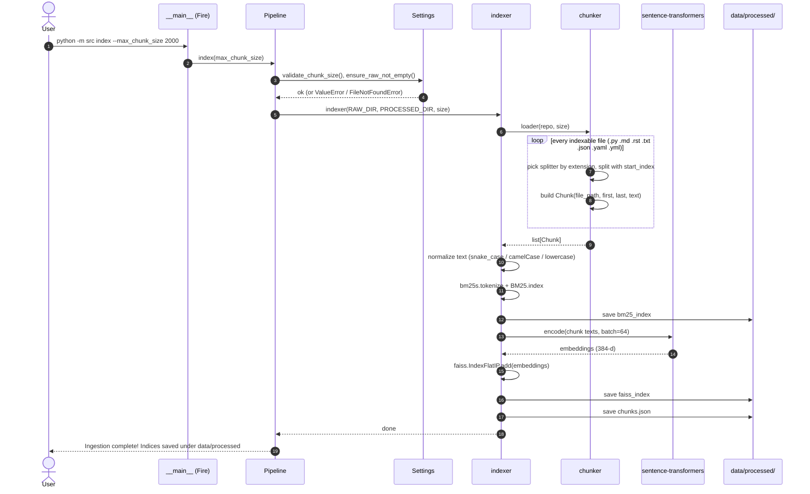
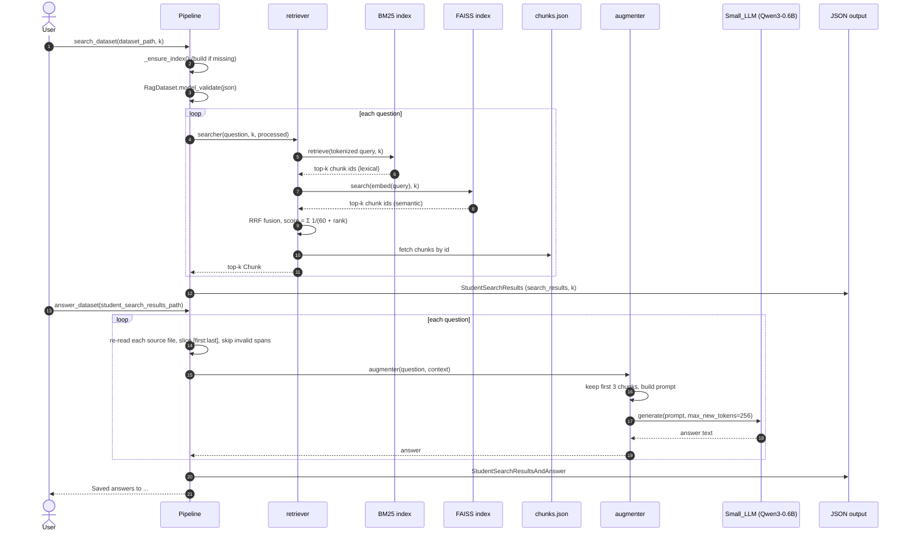
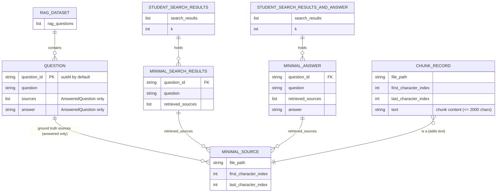
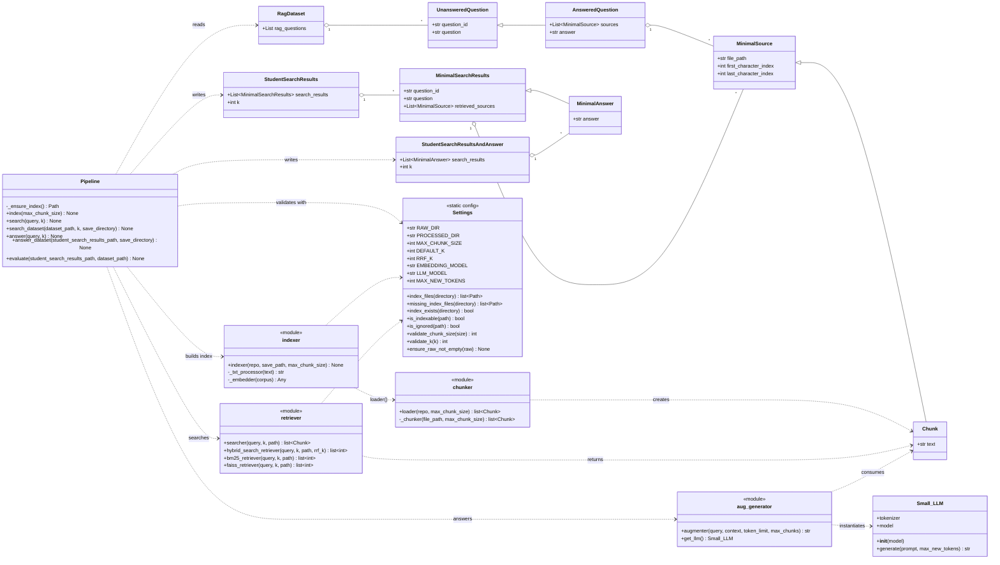

*This project has been created as part of the 42 curriculum by adkhalil.*

# RAG against the machine — *Will you answer my questions?*

A local **Retrieval-Augmented Generation** system that answers questions about the [vLLM](https://github.com/vllm-project/vllm) codebase (v0.10.1). It indexes the repository, retrieves the most relevant snippets with a **hybrid BM25 + dense** search, and hands them to a small local model (**Qwen/Qwen3-0.6B**) to produce a grounded answer.

---

## Table of contents

1. [Description](#description)
2. [Features](#features)
3. [Instructions](#instructions)
4. [Example usage](#example-usage)
5. [System architecture](#system-architecture)
6. [Chunking strategy](#chunking-strategy)
7. [Retrieval method](#retrieval-method)
8. [Answer generation](#answer-generation)
9. [Data model](#data-model)
10. [UML](#uml)
11. [Performance analysis](#performance-analysis)
12. [Design decisions](#design-decisions)
13. [Challenges faced](#challenges-faced)
14. [Project layout](#project-layout)
15. [Resources](#resources)

---

## Description

A language model only knows what it was trained on. Retraining it each time a codebase changes is slow and expensive, so RAG gives the model access to an external source **at answer time** instead.

**Goal.** Given a natural-language question about vLLM, the system must:

1. return the **top-k source locations** (`file_path` + character range) that contain the answer, and
2. generate a short, **grounded** answer from those sources with a 0.6B-parameter model.

**Overview.** The pipeline has the four classic RAG stages:

| Stage | What happens | Where |
|-------|--------------|-------|
| **Indexing** | Files are chunked (≤ 2000 chars) and indexed twice: BM25 (lexical) and FAISS (semantic) | `chunker.py`, `indexer.py` |
| **Retrieving** | BM25 and FAISS rankings are fused with Reciprocal Rank Fusion | `retriever.py` |
| **Augmenting** | The best chunks are put in a prompt with strict “answer from context only” instructions | `aug_generator.py` |
| **Generating** | Qwen3-0.6B writes the answer on CPU or GPU | `llm.py` |

Retrieval quality is measured with **recall@k** (a retrieved chunk counts when it is in the same file and overlaps the reference span with IoU ≥ 0.05).

## Features

**Mandatory**

- Two chunking strategies: Python code and Markdown / text.
- BM25 lexical retrieval (`bm25s`).
- CLI built with Python Fire, progress bars with tqdm.
- Pydantic data models for every structure exchanged between stages.
- Batch search over a JSON dataset, batch answer generation, built-in `evaluate` (recall@k).
- Graceful handling of empty queries, `k <= 0`, missing files / directories and malformed JSON.

**Bonus implemented**

- **Semantic embeddings**: FAISS vector index built with `all-MiniLM-L6-v2` (CPU friendly).
- **Hybrid retrieval**: BM25 + FAISS merged into one ranking with RRF.


## Instructions

### Requirements

- Python **3.10+**
- [`uv`](https://docs.astral.sh/uv/) (the only package manager used)
- Several GB of free disk space (PyTorch CPU build, Qwen3-0.6B weights, MiniLM weights)
- The vLLM repository placed under `data/raw/` (e.g. `data/raw/vllm-0.10.1/`)
- The question datasets under `data/datasets/`

### Installation

```bash
make install          # = uv sync
```

### Makefile rules

| Rule | Description |
|------|-------------|
| `make install` | Install dependencies with `uv sync` |
| `make run` | Index the corpus, then run `search_dataset` on the public docs dataset |
| `make debug` | Same as `run`, under `pdb` |
| `make clean` | Remove `__pycache__` and `.mypy_cache` |
| `make lint` | `flake8` + `mypy` with the mandatory flags |

### Expected data layout

```text
data/
├── raw/                              # corpus to index (vLLM sources)
├── processed/                        # generated by `index`
│   ├── bm25_index/                   #   BM25 index (bm25s)
│   ├── faiss_index                   #   dense vector index
│   └── chunks.json                   #   chunk records (path, offsets, text)
├── datasets/                         # UnansweredQuestions / AnsweredQuestions
└── output/
    ├── search_results/<Scope>/               # output of search_dataset
    └── search_results_and_answer/<Scope>/    # output of answer_dataset
```

### CLI reference

Every command is run as `uv run python -m src <command> [options]`.

| Command | Options | Purpose |
|---------|---------|---------|
| `index` | `--max_chunk_size` (default `2000`, max `2000`) | Chunk `data/raw/` and build the indexes in `data/processed/` |
| `search` | `<query>`, `--k` (default `5`) | Print the top-k sources of a single query |
| `search_dataset` | `--dataset_path`, `--k`, `--save_directory` | Search a whole dataset → `StudentSearchResults` JSON |
| `answer` | `<query>`, `--k` | Retrieve and print a generated answer |
| `answer_dataset` | `--student_search_results_path`, `--save_directory` | Generate answers → `StudentSearchResultsAndAnswer` JSON |
| `evaluate` | `--student_search_results_path`, `--dataset_path` | Print recall@1/3/5/10 against a ground-truth dataset |

If `search`, `search_dataset`, `answer` or `answer_dataset` is called before an index exists, the pipeline builds it automatically.

## Example usage

**1. Build the index**

```bash
uv run python -m src index --max_chunk_size 2000
# Ingestion complete! Indices saved under data/processed
```

**2. Single query**

```bash
uv run python -m src search "How to configure the OpenAI compatible server?" --k 5
# data/raw/vllm-0.10.1/docs/serving/openai_compatible_server.md [9867:11801]
# data/raw/vllm-0.10.1/vllm/entrypoints/openai/api_server.py [267:2201]
# ...
```

**3. Single answer**

```bash
uv run python -m src answer "How do I enable LoRA adapters in vLLM?" --k 5
```

**4. Search a whole dataset**

```bash
uv run python -m src search_dataset \
  --dataset_path data/datasets/UnansweredQuestions/dataset_docs_public.json \
  --k 10 \
  --save_directory data/output/search_results/UnansweredQuestions
```

**5. Evaluate your own recall@k**

```bash
uv run python -m src evaluate \
  --student_search_results_path data/output/search_results/UnansweredQuestions/dataset_docs_public.json \
  --dataset_path data/datasets/AnsweredQuestions/dataset_docs_public.json
```

**6. Generate answers for a dataset**

```bash
uv run python -m src answer_dataset \
  --student_search_results_path data/output/search_results/UnansweredQuestions/dataset_docs_public.json \
  --save_directory data/output/search_results_and_answer/UnansweredQuestions
```

**Output format** (`search_dataset`):

```json
{
  "search_results": [
    {
      "question_id": "q1",
      "question": "How to configure OpenAI server?",
      "retrieved_sources": [
        {
          "file_path": "data/raw/vllm-0.10.1/docs/serving/openai_compatible_server.md",
          "first_character_index": 9867,
          "last_character_index": 11801
        }
      ]
    }
  ],
  "k": 10
}
```

`answer_dataset` adds an `"answer"` field to every entry of `search_results`.

## System architecture

The CLI dispatches to a single `Pipeline` class that orchestrates the indexer, the retriever, the augmenter and the evaluator. Indexes are written once to `data/processed/` and read back at query time.

```mermaid
%% Generated by https://gitdiagram.com/4d4mkhalil/rag-against-the-machine
flowchart TD

subgraph group_interface["CLI and workflows"]
  node_cli["Command entry<br/>[__main__.py]"]
  node_pipeline["RAG workflows<br/>[pipeline.py]"]
  node_settings["Runtime settings<br/>[settings.py]"]
  node_models["Data models<br/>[models.py]"]
end

subgraph group_retrieval["Indexing and retrieval"]
  node_chunker["Document chunking<br/>[chunker.py]"]
  node_indexer["Index construction<br/>[indexer.py]"]
  node_indexstore[("Search indexes")]
  node_retriever["Hybrid retrieval<br/>[retriever.py]"]
  node_chunks[("Chunk records")]
end

subgraph group_answers["Answering and evaluation"]
  node_augmenter["Answer augmentation<br/>[aug_generator.py]"]
  node_llm["Local language model<br/>[llm.py]"]
  node_dataset["Question datasets"]
  node_results["Search and answer files"]
  node_evaluation["Retrieval evaluation<br/>[pipeline.py]"]
end

node_user(("CLI user"))
node_rawdocs["Source documents"]
node_query["Search query"]

node_user -->|"invokes"| node_cli
node_cli -->|"dispatches"| node_pipeline
node_pipeline -->|"validates with"| node_settings
node_pipeline -->|"requests indexing"| node_indexer
node_pipeline -->|"requests search"| node_retriever
node_rawdocs -->|"provides files"| node_chunker
node_indexer -->|"loads chunks"| node_chunker
node_indexer -->|"writes indexes"| node_indexstore
node_indexer -->|"writes records"| node_chunks
node_query -->|"enters workflow"| node_pipeline
node_retriever -->|"loads and searches"| node_indexstore
node_retriever -->|"loads passages"| node_chunks
node_pipeline -->|"requests answers"| node_augmenter
node_augmenter -->|"generates prompt"| node_llm
node_pipeline -->|"loads dataset"| node_dataset
node_pipeline -->|"writes results"| node_results
node_pipeline -->|"evaluates retrieval"| node_evaluation
node_pipeline -->|"validates and builds"| node_models

click node_cli "https://github.com/4d4mkhalil/rag-against-the-machine/blob/master/src/__main__.py"
click node_pipeline "https://github.com/4d4mkhalil/rag-against-the-machine/blob/master/src/pipeline.py"
click node_settings "https://github.com/4d4mkhalil/rag-against-the-machine/blob/master/src/settings.py"
click node_chunker "https://github.com/4d4mkhalil/rag-against-the-machine/blob/master/src/chunker.py"
click node_indexer "https://github.com/4d4mkhalil/rag-against-the-machine/blob/master/src/indexer.py"
click node_retriever "https://github.com/4d4mkhalil/rag-against-the-machine/blob/master/src/retriever.py"
click node_models "https://github.com/4d4mkhalil/rag-against-the-machine/blob/master/src/models.py"
click node_augmenter "https://github.com/4d4mkhalil/rag-against-the-machine/blob/master/src/aug_generator.py"
click node_llm "https://github.com/4d4mkhalil/rag-against-the-machine/blob/master/src/llm.py"
click node_evaluation "https://github.com/4d4mkhalil/rag-against-the-machine/blob/master/src/pipeline.py"

classDef toneNeutral fill:#f8fafc,stroke:#334155,stroke-width:1.5px,color:#0f172a
classDef toneBlue fill:#dbeafe,stroke:#2563eb,stroke-width:1.5px,color:#172554
classDef toneAmber fill:#fef3c7,stroke:#d97706,stroke-width:1.5px,color:#78350f
classDef toneMint fill:#dcfce7,stroke:#16a34a,stroke-width:1.5px,color:#14532d
classDef toneRose fill:#ffe4e6,stroke:#e11d48,stroke-width:1.5px,color:#881337
classDef toneIndigo fill:#e0e7ff,stroke:#4f46e5,stroke-width:1.5px,color:#312e81
classDef toneTeal fill:#ccfbf1,stroke:#0f766e,stroke-width:1.5px,color:#134e4a
class node_cli,node_pipeline,node_settings,node_models,node_user toneBlue
class node_chunker,node_indexer,node_indexstore,node_retriever,node_chunks toneAmber
class node_augmenter,node_llm,node_dataset,node_results,node_evaluation toneMint
class node_rawdocs,node_query toneIndigo
```



### Components

| Module | Responsibility |
|--------|----------------|
| `__main__.py` | Entry point. Exposes `Pipeline` through Fire and turns expected errors into clean messages (no traceback). |
| `pipeline.py` | `Pipeline` class: `index`, `search`, `search_dataset`, `answer`, `answer_dataset`, `evaluate`. Validates inputs, auto-builds a missing index, writes JSON output. |
| `settings.py` | `Settings`: all defaults (paths, chunk size, models, RRF constant) and validation helpers (`validate_k`, `validate_chunk_size`, `index_exists`, …). |
| `models.py` | Pydantic models (`MinimalSource`, `Chunk`, `AnsweredQuestion`, `StudentSearchResults`, …). |
| `chunker.py` | Walks the corpus and splits each file into chunks with exact character offsets. |
| `indexer.py` | Builds and saves the BM25 index, the FAISS index and `chunks.json`. |
| `retriever.py` | Loads (and caches) the indexes, runs BM25 and FAISS, fuses with RRF, returns `Chunk` objects. |
| `aug_generator.py` | Builds the prompt from the retrieved chunks. |
| `llm.py` | `Small_LLM`: wrapper around Hugging Face `AutoModelForCausalLM` (Qwen3-0.6B). |

### Sequence diagrams

**Indexing (`index`)**



**Search and answer (`search_dataset` → `answer_dataset` / `answer`)**



## Chunking strategy

Chunking is done in `chunker.py` with LangChain's `RecursiveCharacterTextSplitter`. The splitter tries a list of separators from the *most* to the *least* meaningful and only falls back to a smaller one when a piece is still too large, so chunks stay as semantically whole as possible.

| File type | Strategy | Separators (high → low priority) |
|-----------|----------|----------------------------------|
| `.py` | **Python code chunking** (`Language.PYTHON`) | `class `, `def `, indented `def `, blank lines, newlines, spaces |
| `.md` | **Markdown chunking** (`Language.MARKDOWN`) | headings `#`…`######`, code fences, horizontal rules, blank lines, newlines |
| `.rst` | `Language.RST` | RST section markers, directives, blank lines |
| `.txt`, `.json`, `.yaml`, `.yml` | Generic text splitting | blank lines, newlines, spaces, characters |

Key points:

- **Hard size limit.** `--max_chunk_size` defaults to **2000** characters and is validated: values `<= 0` or `> 2000` are rejected, so a chunk can never exceed the moulinette's `max_context_length`.
- **No overlap** (`chunk_overlap=0`). Overlap would create duplicate hits for the same region and waste slots in the top-k.
- **Exact offsets.** `add_start_index=True` gives each chunk's start; the end is `start + len(chunk)`. These offsets are what recall@k is computed on, and `answer_dataset` uses them to re-slice the original file.
- **Paths are kept verbatim** (relative to the project root, e.g. `data/raw/vllm-0.10.1/...`) because the grader compares them as-is.
- **Filtering.** Only the extensions above are read; `.git`, `__pycache__`, `.mypy_cache` and `.venv` are skipped. Unreadable files are skipped instead of crashing.

## Retrieval method

Questions and source code rarely share vocabulary: a question may paraphrase an idea or quote an identifier verbatim. The system therefore combines a lexical and a semantic ranking.

1. **BM25 (lexical)** with `bm25s`. Before tokenizing, text (both chunks and queries) is normalized so identifiers match natural language: `_` → space, camelCase is split (`maxNumSeqs` → `max num seqs`), everything is lowercased. `max_num_seqs` in code therefore matches “max num seqs” in a question.
2. **Dense search** with `all-MiniLM-L6-v2` embeddings (384-d) in a FAISS `IndexFlatIP` (exact inner product; the model outputs normalized vectors, so this is cosine similarity). It catches paraphrases that share no words with the code.
3. **Hybrid fusion with Reciprocal Rank Fusion (RRF).** Each retriever returns its top-k; each chunk scores

   ```text
   score(chunk) = Σ over rankers  1 / (RRF_K + rank)      with RRF_K = 60
   ```

   Chunks are sorted by this score and the top-k are returned. RRF uses ranks only, so BM25 scores and cosine scores (different scales) never need to be normalized or weighted.

Retrieval runs in milliseconds per query once the indexes and the embedding model are cached in memory.

## Answer generation

- **Model:** `Qwen/Qwen3-0.6B` through Hugging Face `transformers` (`float32` on CPU, automatic placement when a GPU is available).
- **Context:** the first **3** retrieved chunks (≤ 2000 chars each), each prefixed with its file path.
- **Prompt:** *“Answer the question using only the context. Be concise. If the context is insufficient, say so.”* followed by the context and the question.
- **Settings:** chat template with `enable_thinking=False` (no reasoning trace, faster and shorter), `max_new_tokens=256`.
- **Grounding:** in `answer_dataset` the context is rebuilt from the saved offsets; invalid spans (missing file, `end <= start`, out of range, blank text) are skipped, and if nothing valid remains a fixed fallback message is returned instead of letting the model guess.

## Data model

All data exchanged between stages is validated with Pydantic (`src/models.py`). `Chunk` extends `MinimalSource` with the chunk text and is the record stored in `chunks.json`.



**Files persisted on disk (`data/processed/`)**

| Artifact | Content | Written by |
|----------|---------|------------|
| `bm25_index/` | BM25 sparse index (`bm25s` format) | `indexer.py` |
| `faiss_index` | Dense vectors, row *i* ↔ chunk *i* | `indexer.py` |
| `chunks.json` | List of `Chunk` dicts; the **position in this list is the chunk id** shared by both indexes | `indexer.py` |

## UML

Class diagram of the data models and of the main classes. Modules that expose only functions are shown as `<<module>>`.



## Performance analysis

### Requirements

| Metric | Required | Measured |
|--------|----------|----------|
| Indexing time (whole corpus) | ≤ 5 min | **3 min 26 s** |
| Retrieval throughput (200 questions) | ≤ 90 s | **11 s** |
| Recall@5 100 docs public questions | ≥ 80 % | **83 %** |
| Recall@5 100 code public questions | ≥ 50 % | **63.6 %** |

### Analysis

- **Chunk size.** Larger chunks (up to 2000) keep a function or a documentation section together and raise the chance of overlapping the reference span; smaller chunks are more precise but split answers across several chunks and dilute the top-k. 2000 is the default because it is the maximum the grader accepts.
- **Docs vs. code.** Documentation questions reuse natural-language wording, which both rankers handle well. Code questions depend on identifiers; the snake_case / camelCase normalization in the BM25 step is what makes them matchable.
- **Hybrid vs. single retriever.** BM25 is strong on exact identifiers, dense search on paraphrases. RRF lets either one rescue a question the other misses without tuning any weights.
- **Speed.** Indexing is dominated by the embedding step (CPU encoding of every chunk in batches of 64). At query time everything is in memory (`lru_cache`), so a dataset run is dominated by the one-off model/index loading. Answer generation is by far the slowest stage: a 0.6B model on CPU, up to 256 new tokens per question.

## Design decisions

- **One `Pipeline` class exposed to Fire.** Each public method is a CLI command; shared logic (`_ensure_index`) is factored out and validation lives in `Settings`.
- **Everything configurable lives in `Settings`.** Paths, chunk size, models, RRF constant and generation length are class-level constants instead of magic numbers scattered through the code.
- **BM25 + dense + RRF** rather than a single method: the subject only requires BM25 or TF-IDF, but code search needs both exact-identifier and semantic matching.
- **`bm25s` and `faiss-cpu`.** Both are fast, pure-CPU, and persist to disk, which fits the 5-minute indexing budget and the CPU-only evaluation machines.
- **Flat (exact) FAISS index.** The corpus is small enough that exact search is fast, and it removes approximation error from recall measurements.
- **`chunks.json` as the single source of truth.** Chunk ids are list positions shared by BM25 and FAISS; retrieval returns the stored text and offsets with no second file read.
- **Reciprocal Rank Fusion** because it needs no score normalization or weight tuning.
- **No chunk overlap**, to avoid redundant results.
- **Re-slice sources from disk in `answer_dataset`.** Answer generation depends only on the search-results file (as in the official flow), not on the in-memory index.
- **Thinking mode disabled** for Qwen3 so the 0.6B model answers directly within the token budget.
- **Defensive CLI.** Empty query, `k <= 0`, invalid chunk size, missing raw directory, missing index files and malformed JSON are caught and reported as short messages; the user never sees a traceback.
- **Incremental indexing was intentionally skipped.** It was judged too complex for the benefit; the full index is rebuilt quickly enough.

## Challenges faced

- **Lexical gap between questions and code.** Questions say “max number of sequences”, code says `max_num_seqs`. *Solution:* normalize identifiers (underscores, camelCase, case) the same way at index time and query time, and add the semantic index for true paraphrases.
- **Keeping offsets exact.** Recall is computed on character ranges, so a drifting offset means a miss even with the right text. *Solution:* use `add_start_index=True`, derive the end from the chunk length, and never rewrite the text between chunking and indexing.
- **Hard 2000-character cap.** A single over-long source invalidates the whole output. *Solution:* validate `--max_chunk_size` and rely on the recursive splitter, which never exceeds the requested size.
- **Merging two rankings with incomparable scores.** BM25 and cosine similarities live on different scales. *Solution:* fuse by rank (RRF) instead of by score.
- **Slow repeated loads.** Reloading the indexes and the embedding model for each question would blow the 90 s / 200 questions budget. *Solution:* load them once per process with `lru_cache`.
- **A 0.6B model hallucinates easily.** *Solution:* a strict “use only the context” prompt, only 3 chunks (to stay within a small context window), thinking disabled, and a deterministic fallback message when no valid context exists.
- **Robustness to bad inputs.** The CLI is stress-tested with empty queries, `k=0`, missing files and broken JSON. *Solution:* central validators in `Settings` and a single error handler in `__main__.py`.

## Project layout

```text
.
├── Makefile
├── README.md
├── pyproject.toml
├── uv.lock
├── data/
│   ├── raw/                # vLLM sources (not committed)
│   ├── processed/          # generated indexes (not committed)
│   ├── datasets/           # question datasets
│   └── output/             # generated results (not committed)
└── src/
    ├── __main__.py         # CLI entry point (Fire)
    ├── pipeline.py         # Pipeline: index / search / answer / evaluate
    ├── settings.py         # defaults + validators
    ├── models.py           # Pydantic models
    ├── chunker.py          # Python / Markdown / text chunking
    ├── indexer.py          # BM25 + FAISS index building
    ├── retriever.py        # BM25, FAISS, RRF hybrid retrieval
    ├── aug_generator.py    # prompt construction
    └── llm.py              # Qwen3-0.6B wrapper
```

## Resources

### References

- Lewis et al., *Retrieval-Augmented Generation for Knowledge-Intensive NLP Tasks* (2020) — https://arxiv.org/abs/2005.11401
- Robertson & Zaragoza, *The Probabilistic Relevance Framework: BM25 and Beyond* (2009)
- Cormack, Clarke & Büttcher, *Reciprocal Rank Fusion outperforms Condorcet and individual rank learning methods* (SIGIR 2009)
- Reimers & Gurevych, *Sentence-BERT* (2019) — https://arxiv.org/abs/1908.10084
- Johnson, Douze & Jégou, *Billion-scale similarity search with GPUs* (FAISS) — https://arxiv.org/abs/1702.08734
- [bm25s documentation](https://github.com/xhluca/bm25s)
- [FAISS wiki](https://github.com/facebookresearch/faiss/wiki)
- [LangChain text splitters](https://python.langchain.com/docs/concepts/text_splitters/)
- [sentence-transformers / all-MiniLM-L6-v2](https://huggingface.co/sentence-transformers/all-MiniLM-L6-v2)
- [Qwen3-0.6B model card](https://huggingface.co/Qwen/Qwen3-0.6B)
- [Hugging Face Transformers](https://huggingface.co/docs/transformers)
- [vLLM documentation](https://docs.vllm.ai)
- [Pydantic](https://docs.pydantic.dev), [Python Fire](https://github.com/google/python-fire), [uv](https://docs.astral.sh/uv/), [tqdm](https://tqdm.github.io/)
- [Mermaid](https://mermaid.js.org/) for the diagrams

### Use of AI

AI assistants were used as a support tool, never as a replacement for understanding the code:

- **Code review and refactoring ideas:** review of the structure, default values, error handling for missing files / folders, user-facing messages and package imports, and ideas for moving to an object-oriented layout.
- **Documentation:** drafting this README and generating / checking the Mermaid diagrams (architecture, sequence, data model, UML).
- **Concept explanations:** RRF, BM25 tokenization, FAISS index types, and the Qwen3 chat template.

All AI-suggested code and text was read, tested and, where needed, rewritten before being kept. Every part of the project can be explained and defended during evaluation.
